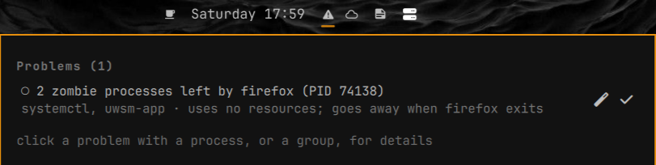

# Idle Watch

An Omarchy shell bar widget that warns about hung processes, heavy CPU/GPU/heat while you are away, and things that are broken on the system.



## What it detects

Checks run every 60 seconds (results are cached for 30 s). Thresholds in bold are configurable, see Settings.

Process checks:

- **Hung orphan process**: a process whose parent is gone (reparented to PID 1 or to systemd), older than **10 min**, averaging at least half a core of CPU over its lifetime. Reported whether you are idle or not.
- **Heavy CPU while idle**: a process using at least **50%** of one core, measured between two checks.
- **Heavy GPU while idle**: NVIDIA dGPU utilization of at least **30%**, read with `nvidia-smi`.
- **High temperature while idle**: CPU package temperature (`coretemp`) of at least **85 C**.

"Idle" means **30 min** without keyboard or mouse input (inhibitors such as video playback are ignored).

System faults (any time):

- Failed or crash-looping (`auto-restart`) systemd units, both user and system.
- Crashes (core dumps) in the last 24 hours, via `coredumpctl`.
- Out-of-memory kills in the last 24 hours (kernel log and `systemd-oomd`).
- Zombie processes, grouped by parent.
- Processes blocked in I/O (state D), seen in two snapshots 1 s apart.
- Partitions at 90% or more: `/`, `/home`, `/boot`, `/efi` (btrfs subvolumes sharing a pool are counted once).

Stale binaries:

- Processes still running an executable that was deleted or replaced on disk (typically after an update), grouped by pacman package.

## Behavior

- The bar icon is a green check when all is well and a warning icon when something is wrong. The panel lists only problems.
- One critical notification per issue. Heavy-use issues, failed units, crashes, OOM kills and full disks notify; zombies, D-state processes and stale binaries only show in the panel.
- A runtime-suspended NVIDIA dGPU is never woken: `nvidia-smi` is only called when the driver reports the GPU as active.
- Acknowledged faults are hidden and remembered in `~/.local/state/omarchy/idle-watch-ack.json`.

## Actions

Per-row actions in the panel:

- Process rows: stop with TERM, a second click sends KILL (the PID and start time are checked first, so a reused PID is never signalled).
- Failed units: restart, or stop and disable (with confirmation; system units go through `pkexec`).
- Crashes, OOM kills, zombies, D-state processes: "seen, hide" (acknowledge).
- Stale-binary groups: stop all (TERM, then KILL after 8 s), or restart on the new version via the systemd unit, or by relaunching the package's `.desktop` launcher with `uwsm-app`.

### Experimental

These actions, and the "Repair with Claude" button, are not fully tested yet. The button opens a new terminal with Claude Code (`~/.local/bin/claude`) briefed on the problem; the prompt asks it to ask for confirmation before stopping, deleting, disabling or installing anything.

## Install

```
omarchy plugin add https://github.com/ionutm87/omarchy-idle-watch.git --enable
```

Update:

```
omarchy plugin update ionutm87.idle-watch
```

Remove:

```
omarchy plugin remove ionutm87.idle-watch
```

## Settings

| Key | Default | Meaning |
| --- | --- | --- |
| `idleMinutes` | 30 | Minutes without input before CPU/GPU/temperature checks start. |
| `cpuPercent` | 50 | Per-process CPU (percent of one core) that counts as heavy while idle. |
| `gpuPercent` | 30 | NVIDIA dGPU utilization that counts as heavy while idle. |
| `tempC` | 85 | CPU package temperature that counts as too hot while idle. |
| `hungMinutes` | 10 | Minutes an orphaned process must average over half a core to be reported as hung. |

## Requirements

- Omarchy shell with bar-widget plugin support, Linux.
- `python3` (standard library only).
- `systemctl`, `journalctl`, `coredumpctl` (systemd).
- `pacman` (Arch Linux) for package ownership and upgrade times of stale binaries.
- `ss` (iproute2) for the process details view.
- `notify-send` for notifications.
- `pkexec` for acting on system units; `uwsm-app` to relaunch desktop apps.
- `nvidia-smi`: optional, only for the GPU check.
- Claude Code and `omarchy-launch-tui`: only for the "Repair with Claude" button.

## Testing

```
./test_check.sh
```

It starts a CPU-burning orphan and a failing user unit (`systemd-run --user`), then checks that they are reported as hung, as heavy CPU when idle, and as a fault that can be acknowledged. It takes about 30 seconds and prints `OK` on success.

## License

MIT, see [LICENSE](LICENSE).
